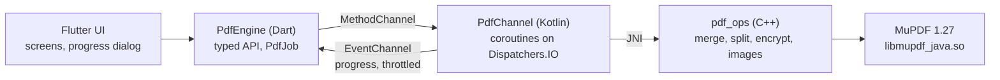

<div align="center">


### Fast, private PDF tools for Android

Merge, split, reorder, protect and create PDFs on your phone, powered by the MuPDF engine.<br>
Everything runs on the device. No uploads, no accounts, no internet permission.

<a href="https://play.google.com/store/apps/details?id=com.bluepdf.blue_pdf">
  
</a>

<br><br>

[](https://github.com/WannaCry016/blue_pdf/actions/workflows/ci.yml)
[](https://developer.android.com/)
[](https://flutter.dev/)
[](https://mupdf.com/)
[](LICENSE)

</div>

---

## Features

| Tool | What it does |
| --- | --- |
| **Merge PDF** | Combines any number of PDFs, including password-protected ones, and keeps links and annotations. |
| **Split PDF** | Extracts pages or ranges such as `1-3, 7, 10-12` into a new PDF. |
| **Reorder PDF** | Drag pages into a new order and rotate them in a thumbnail grid that stays smooth on 300+ page documents. |
| **Protect PDF** | Encrypts a PDF with a password using AES-256. |
| **Image to PDF** | Turns photos into a PDF: JPG, PNG, GIF, BMP and TIFF directly; HEIC and WebP are converted. Respects camera orientation. |
| **Camera** | Capture pages, then crop, rotate or annotate them in the built-in editor before converting. |

Every tool also gets:

- **Live progress and cancel** for large jobs ("Copying page 120 of 330"), while quick jobs finish without a dialog.
- **One-tap saving** to `Download/BLUE PDF`, or any folder you choose. Existing files are never overwritten.
- **Preview and share** the result straight from the success screen.
- **Light and dark themes**, and in-app updates from Google Play.

## Built for speed

BLUE PDF is designed to feel instant. The heavy lifting happens in native code, and the UI only shows what the user needs to see.

- **Native engine.** Every operation runs in C++ on [MuPDF](https://mupdf.com/), off the UI thread. Pages are copied between documents rather than re-rendered, so output keeps its original quality and size.
- **Real progress, not a spinner.** The engine reports pages processed and bytes written, including the final save, which is where large jobs spend their time. Cancelling stops the work mid-page and removes the partial file.
- **No flashing dialogs.** Progress appears only when a job takes longer than 400 ms and stays long enough to read, the same rules as Android's own loading indicators.
- **Streaming I/O.** Results are written to disk in chunks and copied to their destination as a stream, so a 100 MB merge never sits in memory.
- **Cached thumbnails.** Page previews are rendered once at display size and reused.
- **Fast start.** The app opens straight into the home screen. Cleanup of leftovers from earlier sessions runs after the first frame.

## Privacy

- Files never leave the device. The app ships without the `INTERNET` permission.
- No analytics, no ads, no accounts.
- The only runtime permission is the camera, requested when you use it.
- Saving uses Android's MediaStore and the system file picker, so no storage permission is needed on Android 10 and later.

## Architecture



| Layer | Location | Responsibility |
| --- | --- | --- |
| UI | `lib/screens`, `lib/components` | Tools, file selection, page grid, save sheet, progress dialog |
| Engine API | `lib/pdf` | `PdfEngine` (typed calls and error codes), `PdfJob` (progress and cancellation) |
| Platform bridge | `android/app/src/main/kotlin` | `PdfChannel` runs operations off the main thread; `PdfJobs` throttles progress and forwards cancel |
| Native core | `android/app/src/main/cpp` | `pdf_ops` implements every operation on MuPDF; `native-lib` is the JNI glue |
| MuPDF | `android/app/src/main/jniLibs` | Prebuilt `libmupdf_java.so` for each ABI, 16 KB page aligned |

<details>
<summary>Project structure</summary>

```
lib/
  main.dart                 App entry, theme, startup cache cleanup
  screens/                  Home, success, onboarding, about
  components/               Save sheet, progress dialog, page grid, camera, dialogs
  pdf/                      PdfEngine, PdfJob, page ranges, image formats
  services/                 In-app updates
  utils/                    Saving, cache cleanup, file locations
android/app/src/main/
  kotlin/.../               MainActivity, PdfChannel, PdfJobs, PdfNative
  cpp/                      pdf_ops.{h,cpp}, native-lib.cpp, MuPDF headers, native tests
  jniLibs/<abi>/            libmupdf_java.so
test/                       Dart unit and widget tests
tool/native_test.ps1        Builds and runs the native tests on a device
.github/workflows/ci.yml    Analyze, test, build and 16 KB alignment check
```

</details>

## Getting started

### Requirements

- Flutter **3.47.8** (stable)
- Android SDK with the NDK version Flutter selects (installed automatically by Gradle)
- JDK 17

### Run

```bash
git clone https://github.com/WannaCry016/blue_pdf.git
cd blue_pdf
flutter pub get
flutter run
```

MuPDF ships prebuilt in `android/app/src/main/jniLibs`, so there is nothing else to build.

### Test

```bash
flutter analyze          # must report no issues
flutter test             # Dart unit and widget tests
```

The native engine has its own test suite covering every operation, progress reporting and cancellation. It runs on a connected arm64 device:

```powershell
pwsh tool/native_test.ps1 [-Serial <adb serial>]
```

### Release build

Release signing reads `android/key.properties`, which points at your keystore. Both are git-ignored and must never be committed.

```properties
storePassword=...
keyPassword=...
keyAlias=...
storeFile=/absolute/path/to/release.keystore   # or relative to android/app
```

```bash
flutter build appbundle --release
```

Without `key.properties` the build falls back to debug signing, which is fine for testing but cannot be uploaded to Google Play.

## Continuous integration

Every push to `main` or `dev` and every pull request runs [CI](.github/workflows/ci.yml):

1. `flutter analyze` and `flutter test`
2. A release app bundle build
3. A check that every 64-bit native library is 16 KB page aligned, as Google Play requires

## Contributing

1. Branch from `dev` as `feature/<name>` or `fix/<name>`.
2. Keep commits focused, with a summary line in [Conventional Commits](https://www.conventionalcommits.org/) style (`feat:`, `fix:`, `perf:`, `chore:`) followed by a body explaining what changed and why.
3. Make sure `flutter analyze` and `flutter test` pass, and run the native tests if you touched `cpp/`.
4. Open a pull request into `dev`. `main` receives tested releases only.

Bug reports and feature ideas are welcome in [Issues](https://github.com/WannaCry016/blue_pdf/issues).

## License

BLUE PDF is licensed under the [GNU Affero General Public License v3.0](LICENSE).

It includes [MuPDF](https://mupdf.com/) by Artifex Software, also under AGPL-3.0. If you distribute a modified version, or offer it over a network, you must make its complete source code available under the same license.

## Author

Built and maintained by **Ayushman Pal**.

[payushman72@gmail.com](mailto:payushman72@gmail.com) · [GitHub @WannaCry016](https://github.com/WannaCry016)

<div align="center">
<br>
If BLUE PDF saves you time, a ⭐ on GitHub or a review on Google Play helps a lot.
</div>
